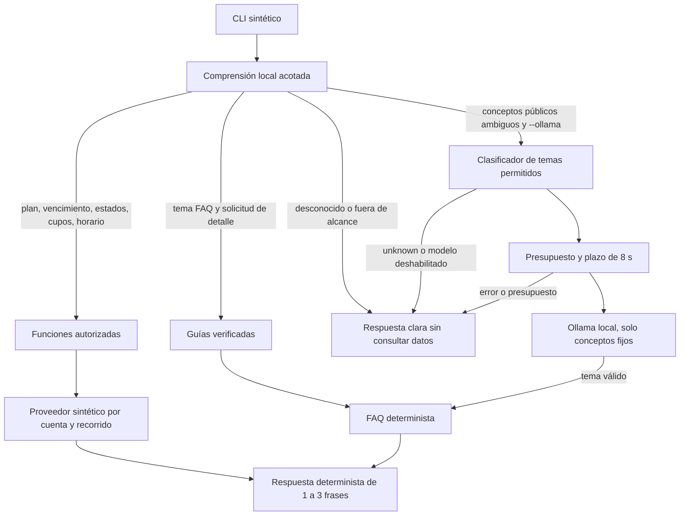

# Task 14 — asistente local FurgoPlus

Prototipo independiente, de solo lectura, con Python estándar (3.11+ y base de
zonas horarias del sistema). No requiere Django, Ollama, pip ni contenedores para
las pruebas sin conexión. Trabajar desde la raíz de este worktree, en
`task/14-local-assistant`. No importar este paquete desde el backend activo.

Corrección factual y de intenciones del 28/10/2026 tras la aceptación en Fedora:
Básico sin informes mensuales, Pro con mensuales, Elite añade avanzados y XLSX;
sin contratación ni pago comercial dentro de FurgoPlus. Se revisó el catálogo
académico T12 `2026-10-19.3` en lectura; ver [procedencia y vigencia](SOURCES.md).
Las preguntas públicas claras se responden directamente desde FAQ. El modelo
solo interpreta consultas ambiguas mediante conceptos fijos, sin texto original
ni datos privados. Se retiró la selección de frases mediante IA.

Continuación híbrida del 29/10/2026: [base y mantenimiento](KNOWLEDGE.md),
[catálogo JSON](knowledge.json) y [evaluación local](QUALITY_REPORT.json).
La búsqueda usa equivalencias completas y reglas conservadoras; los estados
particulares tienen prioridad y nunca se obtienen de la base pública.
No se necesita caché de respuestas, base vectorial ni entrenamiento.

Qwen3 0.6B, un hilo y timeout de 8 s se mantienen. No se modifica la instalación
ni el túnel. Ver [aceptación en Fedora](ACCEPTANCE.md) y [evidencia](REVIEW.md).
Las guías de infraestructura anteriores son históricas; este lote no requiere
instalaciones, otros modelos ni despliegue.

Revisión de cierre T14: [alcance, rendimiento y validación](T14_REVIEW.md).
El modo híbrido sigue **pendiente de aprobación real bajo 8 s**. Se acortó el
prompt sin alterar candidatos ni esquema; no hay medición nueva de Ollama desde
el sandbox. Las solicitudes mixtas de código, evasión, datos ajenos y hechos
inventados se rechazan antes de recuperar FAQ o consultar cuentas. Las consultas
técnicas de soporte no se rechazan por mencionar SQL, HTML, API, token o XLSX.

## Prueba inmediata sin instalaciones

```bash
cd ~/Proyectos/furgoplus-ai
python3 -B -m local_assistant
python3 -B -m local_assistant.evaluate
python3 -B -m local_assistant.quality --repeats 200
python3 -B -m local_assistant.acceptance
python3 -B -m unittest discover -s local_assistant/tests -v
python3 -B -m local_assistant.hardware
```

Para diagnóstico de servicios en Debian, sin instalaciones ni cambios, usar
`python3 -B -m local_assistant.hardware --services`. Se ejecuta manualmente y
solo consulta metadatos; revisar la salida antes de compartirla.
Para comprobar un Ollama ya instalado, sin inferir ni descargar:

```bash
python3 -B -m local_assistant.probe --port 11435 --model qwen3:0.6b
```

11435 es el túnel existente en Fedora hacia 127.0.0.1:11436 en Debian.
La sonda consulta GET de versión, modelos instalados y cargados; informa digest
del candidato y estimación de tamaño cargado, sin divulgar otros nombres de
modelos. API/pesos presentes no garantizan una inferencia válida ni RAM suficiente.

El CLI anuncia **datos sintéticos y fecha fija 26/10/2026**. Ejemplos:

| Pregunta | Respuesta esperada, cuenta demo-a |
| --- | --- |
| ¿Qué plan tengo? | Tu plan es Pro y está activo. |
| ¿Cuándo vence mi plan? | El vencimiento de tu plan es el 01/11/2026 a las 00:00 (hora de Chile). |
| ¿Cuántos cupos hay hoy? | Hay 3 cupos disponibles para el 26/10/2026 en el recorrido seleccionado. |
| ¿Cómo va mi validación? | Tu validación está aprobada. |
| ¿Está publicado mi servicio? | Tu servicio está publicado. |
| ¿Aceptar una solicitud reserva un cupo? | Aceptar una solicitud no reserva ni asigna un cupo automáticamente. |
| ¿Qué diferencia hay entre Básico y Pro? | Básico sin mensuales; Pro con mensuales; Elite añade avanzados y XLSX; sin contratación/pago comercial habilitados. |
| ¿Cómo puede un apoderado solicitar transporte? | Buscar → comuna → servicio → solicitud de contacto con permiso para compartir correo; sin reserva de asiento. |
| ¿Puedo contratar el plan Elite y pagarlo directamente en FurgoPlus? | No hay contratación ni pago comercial dentro de FurgoPlus; precios como propuestas futuras. |
| ¿Va a llover? | Explica que falta información verificada y ofrece los temas disponibles. |

`--actor demo-b` selecciona la segunda cuenta sintética (sin plan, cero cupos,
validación pendiente y sin publicación); `--no-route` verifica la solicitud de
seleccionar un recorrido. Estas opciones simulan un contexto autenticado: **no
son autenticación**. `/salir` termina. El CLI admite varias preguntas pero no
conserva historial ni resuelve referencias como «¿y eso?»; repite el tema.

Para una pregunta desde entrada estándar, sin incluirla en argumentos:

```bash
python3 -B -m local_assistant --once
```

Añade «en detalle» y repite el tema para recibir hasta tres frases. Para observar
el origen sin registrar preguntas ni datos de cuenta:

```bash
python3 -B -m local_assistant --ollama --port 11435 --diagnostics
```

La respuesta va a stdout; los indicadores van a stderr. `model_attempted` indica
un intento del cliente. `model_invoked` es `true` tras una respuesta válida,
`false` si no se intentó y `null` si un fallo impide confirmar qué hizo el
servidor (timeout, error HTTP o salida inválida). Esto no prueba la identidad del servidor. Los
estados `timeout`, `transport_error`, `invalid_output`, `budget_rejected`,
`disabled`, `not_needed` y `unknown` distinguen fallos y decisiones sin exponer
excepciones, cuerpos HTTP, preguntas, cuentas o valores consultados. `route` es
una etiqueta fija; `elapsed_ms` mide todo el turno. `budget_reason` distingue
`concurrency`, `rate_limit` y `circuit_open` cuando `model_status=budget_rejected`.
Una FAQ directa informa `source=faq`, `model_status=not_needed`, también con
`--ollama`. `faq_fallback` significa que falló la interpretación de una pregunta
ambigua: reconoce incertidumbre y ofrece temas sin adivinar entre candidatos.
No se escriben logs. `--metrics` añade contadores agregados por sesión en stderr
al salir; ver su semántica en [KNOWLEDGE.md](KNOWLEDGE.md).

## Arquitectura y límites



1. `understanding.py` prioriza privacidad y consultas particulares; para hechos
   públicos exige una equivalencia completa o regla revisada de `retrieval.py`.
   Reconoce las intenciones autorizadas por reglas locales, ordena hasta tres
   temas según la pregunta y extrae fechas ISO/hoy/mañana. Una fecha ambigua pide
   precisión. Para algunas variantes públicas ambiguas produce conceptos de un
   vocabulario cerrado; el modelo interpreta esos conceptos, nunca texto libre.
2. `data.py` define cuatro funciones explícitas: `plan`, `capacity`,
   `publication`, `route`. Plan incluye vencimiento; publicación incluye estado
   de validación. Todas comprueban actor, rol y propiedad cuando corresponde.
   Solo devuelven DTO mínimos; no objetos Django ni serializers completos.
3. `assistant.py` construye respuestas a partir de esos datos, sin modelo, sin
   memoria de cuenta entre turnos y sin inferir pagos, fechas o estados.
4. `knowledge.json` contiene 12 conocimientos públicos versionados. `guides.py`
   valida y carga una vez el catálogo, conservando la interfaz de las nueve FAQ
   anteriores. `retrieval.py` indexa equivalentes y reglas completas, sin caché de
   consultas. Se incluye la comparación académica de
   planes y una respuesta explícita sobre contratación/pago comercial no
   habilitados. [SOURCES.md](SOURCES.md) registra la procedencia, fecha, versión,
   hashes y el supuesto antiguo de igualdad de planes que se dejó de usar.
   La recuperación pública es directa, sin inferencia ni dependencias de T12.
5. `ollama.py` consulta `/api/chat` solo para clasificar conceptos públicos de
   consultas ambiguas. Recibe etiquetas de vocabulario cerrado y temas fijos,
   nunca el texto original ni una versión «anonimizada». Devuelve JSON con un
   tema permitido o `unknown`; después se renderiza FAQ sin una segunda llamada.
   No genera hechos, elige frases ni decide permisos sobre datos privados.
6. `worker.py` ejecuta HTTP en un hijo limitado que el padre termina y recoge al
   vencer el plazo. La biblioteca HTTP usa la dirección numérica loopback, no
   sigue redirecciones ni utiliza proxies de entorno. No hay endpoint configurable
   remoto, herramientas, consultas SQL, ejecución de código sugerido ni escritura
   de cuentas. El puerto local puede variar para un túnel SSH.

El beneficio adicional propuesto es interpretar variantes como «Soy mamá, busco
furgón y necesito orientación para empezar» o «FurgoPlus ofrece funciones para
una demo académica». Los tests con dobles verifican el flujo; la calidad de Qwen
real en este lote sigue pendiente. El vocabulario cerrado pierde orden y matices;
un tema válido puede ser irrelevante, aunque no puede introducir hechos nuevos.
Las preguntas conocidas reciben su FAQ íntegra sin depender del modelo, del
presupuesto ni de la red. Una pregunta sin sustento ofrece ejemplos concretos para continuar.

No hay integración de ejecución con React, Flutter, Django, Task 12 o Task 13. No se encontró
un módulo FAQ en este checkout de `origin/main`; esta tarea agrega su propia
alternativa mínima y no altera ningún asistente existente en otros worktrees.
La futura integración deberá preservar la FAQ existente como alternativa, con
una prueba específica sobre el código que la implemente.

## Contrato para Django, solo diseño

`AuthorizedQueries` es el punto futuro de adaptación. Ningún módulo carga Django,
variables de credenciales, rutas privadas ni archivos de otros worktrees. El
proveedor real **todavía no está implementado ni conectado**. Su contrato será:

| Función | Autorización y dato mínimo | Fuente local revisada como referencia |
| --- | --- | --- |
| `plan(actor)` | Sesión activa de conductor; plan propio o ausencia confirmada; estado efectivo y fin con zona horaria | `backend/drivers/publication.py:publication_json`, `DriverSubscription` |
| `capacity(actor, route_id, day)` | Recorrido propio y autorizado; fecha efectivamente consultada y conteo agregado, sin pasajeros | `backend/drivers/capacity.py:capacity_snapshot` |
| `publication(actor)` | Conductor dueño; estado de validación y decisión efectiva de visibilidad | `backend/drivers/publication.py:publication_state` |
| `route(actor, route_id)` | Conductor dueño; días y horarios generales | `backend/drivers/publication_api.py:route_json` proyectado por lista permitida |

El actor y recorrido deben derivarse de la sesión y selección autorizada del
servidor, nunca de IDs devueltos por IA ni de texto del usuario. Una cuenta
administrativa no obtiene permisos sobre datos operativos ajenos. Apoderados no
están soportados por este simulador; una futura búsqueda requerirá otro contrato
con elegibilidad y permisos específicos.

Distinciones necesarias para la adaptación real:

- `capacity_snapshot(route, today)` actual calcula la **próxima** fecha de
  servicio, no necesariamente el día solicitado. El adaptador debe resolver esa
  diferencia y devolver una fecha explícita. El prototipo rechaza fechas de
  respuesta distintas de las solicitadas; no extrapola las fixtures a otro día.
- Cupos significa **asientos para un recorrido y fecha**, no límites comerciales
  del plan. No se inventan cuotas de Task 12 ni se fijan sus contratos futuros.
- Publicación solicitada no equivale a visible. Django debe resolver vigencia,
  revisión, documentos y requisitos; el modelo no evalúa reglas de publicación.
- El estado efectivo del plan debe resolverse al consultar, considerando sus
  instantes de inicio/fin. No confundir el campo administrativo `active` con una
  vigencia efectiva. No reinterpretar el instante de fin como «último día completo».
- Ausencia confirmada de plan es `None`; fallas, falta de permiso o datos no
  disponibles son `DataUnavailable`. Nunca responder «sin plan» a una falla de red.
- Proyectar solo los campos del contrato. No pasar `route_json` completo (contiene
  destino privado), observaciones libres ni registros de personas al modelo.

## Privacidad y protección de recursos

La pregunta solo vive en memoria durante el turno. No se crean archivos de
conversación, base de datos, telemetría, historial de consola ni logs de cuerpos.
La salida se muestra en la terminal; su scrollback o una redirección externa
quedan bajo control del operador. Usar datos sintéticos durante toda la revisión.

La exclusión del texto original del payload es estructural, no depende de una
lista de teléfonos/domicilios para redactarlos. Los rechazos por tema son ayuda
de UX, no un filtro de datos personales. Solo catálogo y conceptos fijos cruzan al modelo;
no cruzan cuenta, fechas de plan, cupos ni DTO, tampoco nombres de recorridos.

| Control | Valor inicial |
| --- | --- |
| Tamaño de pregunta | 1.000 caracteres; lectura de terminal acotada |
| Inferencias simultáneas | 1 por proceso, sin cola del cliente |
| Frecuencia | 6 inicios/minuto por proceso, compartidos entre clientes |
| Tiempo total | 8 s por defecto y máximo; incluye arranque del hijo y HTTP |
| Tras una falla | Circuito abierto durante 30 s; sin reintentos automáticos |
| Respuesta HTTP | Máximo 16 KiB; JSON completo, `done:true`, finalización `stop` |
| Contexto/salida | 1.024 tokens / 24 para clasificación; `think:false`, sin streaming |
| CPU solicitada | 1 hilo por defecto; rango 1–4 |
| Residencia del modelo | 60 s después de uso |
| Respuesta al usuario | 1–3 frases, también ante falla de IA |

Los límites del cliente son **por proceso**: ejecutar varios CLI multiplica la
carga. El Compose propuesto limita la instancia dedicada de Ollama a una CPU y
2 GiB sin swap; el ejemplo systemd anterior es una alternativa sin aplicar.
No hay un servidor web
multiusuario autorizado en esta tarea. Un timeout corta el cliente, pero no
garantiza que Ollama cancele inmediatamente una inferencia iniciada; concurrencia
del servidor y límites de CPU/memoria siguen siendo necesarios.

## Evaluaciones y revisión pendiente

`quality.py` evalúa 56 casos y latencia local repetida, con oráculo independiente
y negativas cercanas; ver [resultados y límites](KNOWLEDGE.md).
`evaluate.py` compara texto y origen exactos para plan, vencimiento, cupos,
validación, publicación, horario, FAQ, pregunta desconocida, IA no disponible y
las tres consultas reportadas con paráfrasis (23 casos). `acceptance.py` usa un
oráculo independiente de `GUIDES`: 18 casos de respuestas públicas y controles;
con `--ollama`, añade dos interpretaciones ambiguas estrictas. Un texto falso
falla aunque su ruta sea correcta. La suite verifica con respuestas alteradas
que una FAQ incorrecta no pueda aprobar la aceptación por comparación consigo
misma. También cubre privacidad, diagnósticos y frío/caliente con dobles.
Los tests además comprueban aislamiento entre dos cuentas, roles, rutas ajenas,
ausencia de mutadores, datos inválidos, zonas horarias, brevedad, clasificación
validada, límites de frecuencia, concurrencia y plazo total del subproceso.

La suite incluye pruebas de HTTP real contra un servidor efímero en loopback,
sin Ollama ni contenedores. Si el sandbox prohíbe sockets se marcan omitidas,
nunca como verificadas. En un host autorizado exigir su ejecución con:

```bash
FURGOPLUS_REQUIRE_WIRE_TESTS=1 python3 -B -m unittest discover -s local_assistant/tests -v
```

Con esa variable un bloqueo de sockets produce error. Deben ejecutarse antes de
aceptar compatibilidad HTTP. No equivale a probar Ollama. Ver
[aceptación real y mediciones](ACCEPTANCE.md) y [evidencia](REVIEW.md).
Sin commit, push, merge ni deploy; detenerse para revisión humana.
